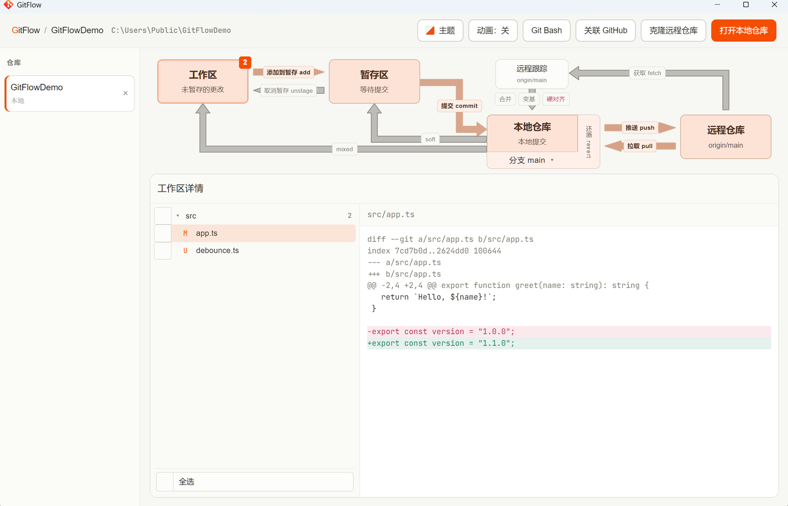

# GitFlow

Windows 上的 Git / GitHub 可视化客户端。闭源软件，安装包在本仓库提供。

GitFlow 把「工作区 → 暂存区 → 本地仓库 → 远程仓库」画成一张可以点的图。点方块看里面的文件和提交，点箭头执行 add、commit、push、pull，操作完成后状态会顺着箭头动一下。刚开始用 Git 的时候，这比对着终端猜自己走到哪一步要直观。

## 功能

- 四区状态图：工作区、暂存区、本地仓库、远程仓库，以及 fetch 后的远程跟踪
- 文件树、diff 和提交历史浏览
- add / unstage / commit / fetch / pull / push，顶栏常驻 ahead / behind
- 打开本地仓库、克隆远程仓库、多个仓库之间切换
- 分支切换、新建、删除；合并前可以预览会带进来哪些提交
- rebase 向导，支持继续和中止
- 冲突分块展示，可以保留当前版本、保留传入版本或手工修改
- Issues / PR 列表、详情、评论；创建 PR、合并 PR、检出 PR 分支
- 浅色 / 深色主题，动画可以关掉

GitFlow 不替代编辑器。看改动、做 Git 操作是它的活，改代码还是回 IDE。

## 下载

当前版本 v1.1.0，需要 64 位 Windows 10 或 11。

| 文件 | 说明 |
| --- | --- |
| [GitFlow_1.1.0_x64-setup.exe](download/GitFlow_1.1.0_x64-setup.exe) | 安装版，推荐 |
| [gitflow.exe](download/gitflow.exe) | 便携版，免安装 |

安装包和程序没有代码签名，第一次运行可能会被 Windows SmartScreen 拦一下。点「更多信息」，再点「仍要运行」就行。

SHA-256 校验值在 [download/SHA256SUMS.txt](download/SHA256SUMS.txt)。

## 使用前

- 安装 [Git for Windows](https://git-scm.com/download/win)，安装时勾选把 Git 加入 PATH
- 要用 Issues / PR 的话，安装 [GitHub CLI](https://cli.github.com/) 并执行 `gh auth login`，或者设置环境变量 `GH_TOKEN`

推送和拉取使用的是系统里 Git 已有的凭据（SSH key 或 Windows 凭据管理器）。GitFlow 不收集也不保存 GitHub 密码和 token，应用里没有登录框。

## 上手

1. 打开 GitFlow，选择「打开本地仓库」，或者粘贴 GitHub 地址克隆一个仓库
2. 改完代码，点「工作区」，左侧会列出未暂存的文件，点文件查看 diff
3. 点工作区旁边的「添加到暂存 add」
4. 点「提交 commit」，填写提交说明
5. 看顶栏的 ahead / behind，然后「推送 push」，或者先「拉取 pull」

远程仓库还没绑定的话，点「关联 GitHub」把 origin 加上。

## 数据放在哪

仓库列表和界面偏好保存在 `%APPDATA%\GitFlow\`。删除这个目录等于重置界面状态，不会动你的代码仓库。

卸载：安装版在「设置 → 应用」里卸载，便携版直接删掉 exe。

## 常见问题

**提示找不到 git？**

GitFlow 调用系统里的 git 命令。确认 Git for Windows 已安装，并且 `git --version` 在终端里能正常输出。装完之后可能需要重新打开 GitFlow。

**push 或 pull 失败，提示认证错误？**

先在终端里对同一个仓库手动执行一次 `git push`，确认凭据可用。SSH 用户检查 key 是否已加载，HTTPS 用户在 Windows 凭据管理器里确认 GitHub 凭据。

**Issues / PR 页面加载不出来？**

这部分依赖 `gh`。执行 `gh auth status` 看看是否已登录。没装 gh 的话，设置 `GH_TOKEN` 也可以。

**为什么只有 Windows？**

打包和交互都是照 Windows 做的，暂时没有 macOS 和 Linux 版本的计划。

**会开源吗？**

目前没有开源计划。这个仓库只放安装包、说明和版本记录，应用源码不公开。

## 反馈

Bug 和建议请提到 [Issues](../../issues)。提交时带上这些信息会方便定位：

- GitFlow 版本
- Windows 版本
- 复现步骤和期望结果
- 能复制的报错原文，或者截图

不要把 token、密码、私人仓库地址贴进 issue。

## 版本记录

见 [CHANGELOG.md](CHANGELOG.md)。

## 许可证

闭源专有软件。允许下载、安装和使用，不允许修改、反向工程或再分发。完整条款见 [LICENSE](LICENSE)。

---

Copyright © 2026 GitFlow
